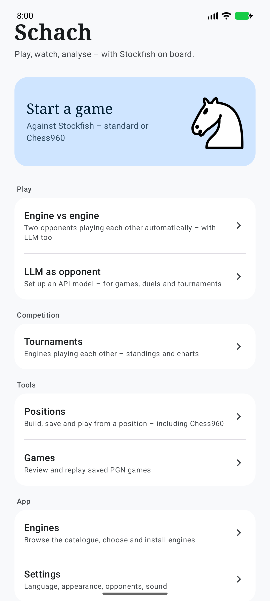
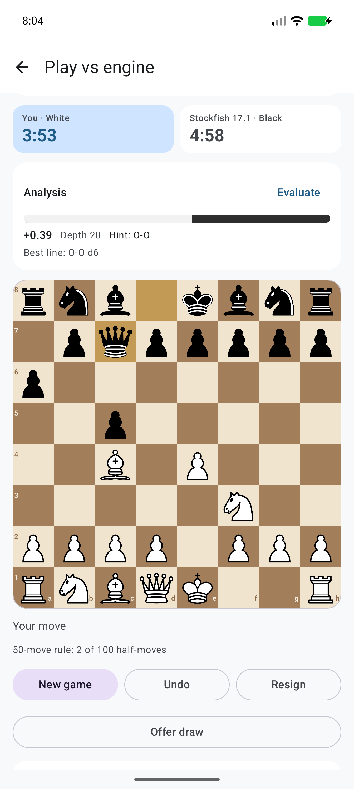
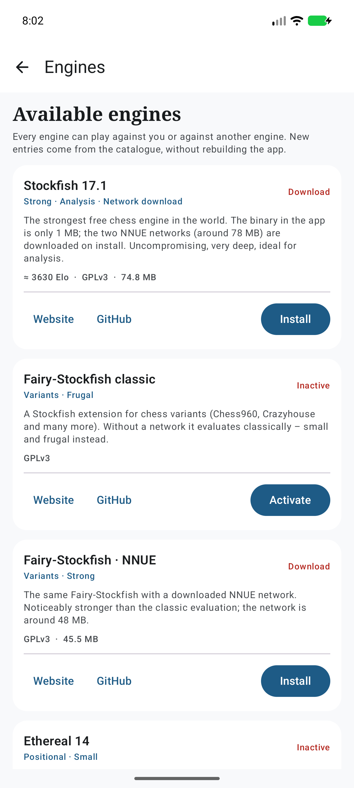
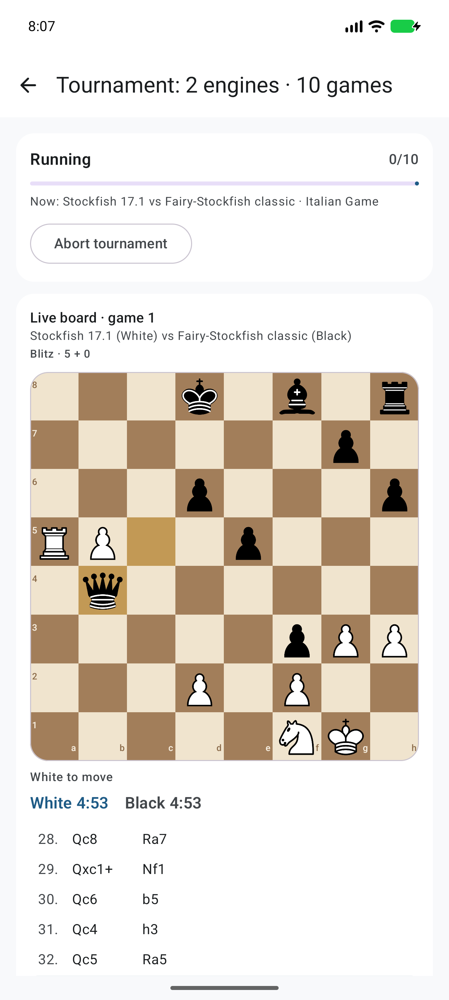
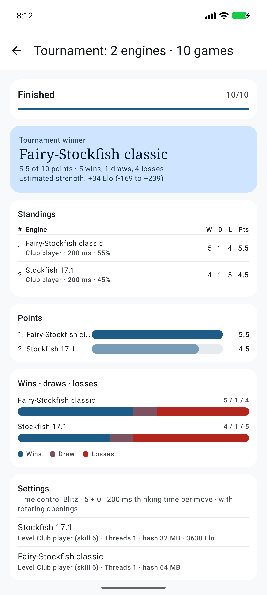
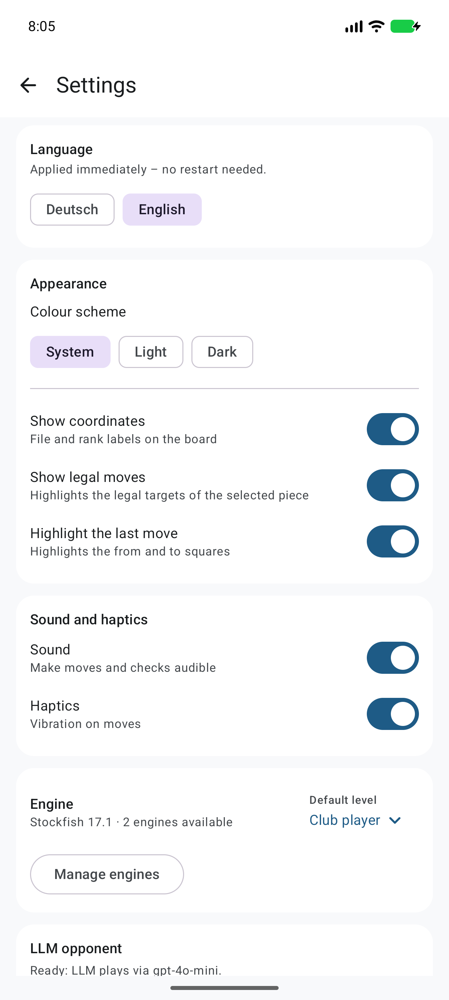

# Schach

**A native Android chess app — play, watch and analyse.** Kotlin and Jetpack
Compose with Stockfish, Fairy-Stockfish, Ethereal and Monolith on board, the
neural Maia 3 as a human-like opponent, and any OpenAI-compatible chat model as
a player.

*Schach* is German for chess; the app itself is fully translated into English.

<table>
  <tr>
    <td></td>
    <td></td>
    <td></td>
  </tr>
  <tr>
    <td align="center">Menu</td>
    <td align="center">Play Stockfish, with live analysis</td>
    <td align="center">Engine store</td>
  </tr>
  <tr>
    <td></td>
    <td></td>
    <td></td>
  </tr>
  <tr>
    <td align="center">Live board while a tournament runs</td>
    <td align="center">Standings, Elo estimate and charts</td>
    <td align="center">Settings</td>
  </tr>
</table>

Screenshots taken on a Pixel 10 Pro XL emulator (Android 17, API 37), English UI.

## Download

Beta builds are published as GitHub pre-releases:

**[Download the latest beta APK](../../releases/latest)**

- Android 8.0 (API 26) or newer, `arm64-v8a` or `x86_64`.
- Signed with a self-signed release key, so Android shows the usual "install from
  an unknown source" prompt; Play Protect may ask for confirmation.
- All four engines ship inside the APK — only the NNUE and ONNX networks are
  downloaded on demand (see [Engines and networks](#engines-and-networks)).
- This is a beta: expect rough edges, and app data may not survive every update.

To build it yourself instead, see [Building](#building).

## Features

### Playing

- **Human vs engine** — pick any installed engine and a skill level, or leave the
  clock off and take your time
- **Analysis while you play** — evaluation bar, best move and principal variation
  from the engine; missing evaluations simply stay empty instead of showing
  nonsense
- **Full rules** — castling, en passant, promotion, check/mate/stalemate, the
  50-move rule, threefold repetition and insufficient material
- **Two rule sets** — standard chess and **Chess960**, including castling over the
  real rook squares and Shredder-FEN; Stockfish gets the matching UCI option
- **Undo, resign, offer a draw**, last-move and legal-move highlighting,
  coordinates, sound and haptics per move
- **Time controls** — bullet, blitz, rapid, classical and correspondence, from
  1+0 to 60+30 (and "no clock"), with increment and a real flag fall

### Watching

- **Engine vs engine** — two independent engine processes, two skill levels,
  start/pause/resume/abort, clock from the same time controls
- **Tournaments** — two or more engines, 10 to 100 games, round robin with both
  colours, live board with move list and running clocks, standings, points,
  estimated Elo difference with confidence interval, bar and stacked charts and
  a crosstable
- Runs as a **foreground service**, so a tournament keeps playing with the screen
  off. If the process is killed the tournament is paused and can be resumed with
  only the missing games
- Every tournament game starts from one of **27 opening positions** (or from a
  different Chess960 start position if that rule set is selected)

### Opponents

- **Stockfish**, **Fairy-Stockfish**, **Ethereal**, **Monolith** and the neural
  **Maia 3** — nothing is active out of the box; you choose during the first run
- Engines are downloaded and updated from the **catalogue** (a JSON file in the
  app, optionally extended by a second catalogue URL). Each entry shows
  description, Elo, licence and links to the project website and source
- **LLM as opponent** — any OpenAI-compatible chat API (address, model, optional
  key) plays as an engine: human vs LLM, engine vs LLM, LLM vs LLM, and as a
  participant in tournaments. Every proposed move is validated against the legal
  moves, so an overconfident model cannot cheat

### Records

- Finished games are stored in **Room** with result, termination reason and PGN,
  with statistics and a PGN view you can share
- Replay any saved game on the board move by move, import PGN from the clipboard
- **Position editor** — place pieces, set side to move and castling rights, read
  and write FEN, validate, save, and play or analyse from there; random Chess960
  start positions included

## Tech stack

| Area | Implementation |
| --- | --- |
| Language / UI | Kotlin, Jetpack Compose, Material 3 |
| Architecture | ViewModel + StateFlow, strict separation of UI, game logic and engines |
| Navigation | Compose Navigation |
| Persistence | Room (`SavedGame`, tournaments), SharedPreferences for settings |
| Engines | Native UCI executables in `jniLibs/<abi>/lib*.so`, one process per engine, driven over stdin/stdout |
| Neural engine | ONNX Runtime + Maia 3 model files |
| LLM opponent | `LlmEngine` implementing `ChessEngine` against an OpenAI-compatible chat API |
| Min / target SDK | 26 / 37, ABIs `arm64-v8a` and `x86_64` |

## Building

Requirements: JDK 17+, Android SDK with platform 37 and build-tools. The engine
binaries are part of the repository, so the NDK is **not** needed for a normal
build.

```bash
# point the build at your SDK
echo "sdk.dir=/path/to/Android/Sdk" > local.properties

./gradlew assembleDebug
adb install -r app/build/outputs/apk/debug/app-debug.apk
```

Release build (unsigned):

```bash
./gradlew assembleRelease
```

Rebuilding the engine binaries is only necessary if you change the engines. It
needs NDK r28 (`28.2.13676358`) and about 15 minutes:

```bash
./tools/build-stockfish.sh   # Stockfish 17.1 + patch, both ABIs
./tools/build-engines.sh     # Fairy-Stockfish, Ethereal, Monolith
```

## Engines and networks

The binaries are small on purpose: the NNUE networks are **not** compiled in.

| Engine | Binary | Downloaded network |
| --- | --- | --- |
| Stockfish 17.1 | ~1.1 MB | 2 NNUE nets, ~78 MB |
| Fairy-Stockfish (classic) | ~1.5 MB | — |
| Fairy-Stockfish (NNUE) | ~1.5 MB | 1 net, ~46 MB |
| Ethereal 14 | ~0.3 MB | — |
| Monolith 2.01 | ~0.9 MB | — |
| Maia 3 (5M / 23M) | — (ONNX Runtime) | 10 MB / 44 MB `.onnx` |

Downloads happen in the engine store, are verified against a SHA-256 checksum
and can be removed again. Android 10+ does not allow executing binaries from app
storage, which is why the engines themselves ship inside the APK while only
data is downloaded.

## LLM opponent

Settings → *LLM opponent* takes a base URL, a model name and an optional API key.
Defaults are `https://api.openai.com/v1` and `gpt-4o-mini`; the key is required
there. Local servers work as well, e.g. `http://192.168.1.10:11434/v1` for Ollama
or LM Studio — no key needed. There is a connection test in the settings screen.

## Privacy

- No analytics, no telemetry, no ads, no accounts
- The only network traffic is engine/model downloads (from the URLs in
  `app/src/main/assets/engines/catalog.json`) and the LLM requests you configure
- The LLM key is stored in the app's private SharedPreferences and only sent to
  the endpoint you entered
- `usesCleartextTraffic` is enabled so that a local LLM server on plain HTTP
  works; nothing else contacts plain HTTP endpoints

## Project layout

```
app/src/main/java/org/example/schach/
  chess/        board, move generation, rules, Chess960, FEN/SAN/PGN, clocks
  engine/       engine protocol, UCI and ONNX backends, LLM engine, packs
  data/         Room database, settings, PGN import/export
  service/      foreground service for tournaments
  ui/           Compose screens, view models, navigation, i18n
app/src/main/assets/engines/catalog.json   engine catalogue
app/src/main/assets/openings/standard.json 27 opening positions
app/src/main/jniLibs/                      prebuilt engine binaries
tools/                                     build scripts for the engines
patches/                                   Stockfish source patch
LICENSES/                                  third-party licences
docs/screenshots/                          screenshots used in this README
```

## Tests

The suite runs on the JVM, no device needed:

```bash
./gradlew testDebugUnitTest
```

- `PerftTest` — move generation against known perft counts (start position to
  depth 4 = 197,281 nodes, Kiwipete, …)
- `GameLogicTest` — SAN, castling, en passant, promotion, mate/stalemate,
  repetition, PGN output
- `PgnTest` — PGN import and export round trips
- `Chess960Test` — castling over rook squares, Shredder/X-FEN, 50 random starts,
  a complete engine game in Chess960
- `PositionValidationTest` — editor validation, FEN round trip
- `TimeControlTest` — time control stages and clock formatting
- `EnginePackTest` — catalogue merging and derived fields
- `TournamentLogicTest` — schedule, colour balance, standings, crosstable, Elo
  conversion, all 27 openings
- `TournamentRunnerTest` — real games with the built-in engine, including the
  live board
- `Maia3EncodingTest` — tokenisation, mirroring, move indices; with
  `-PmaiaModel=/path/to/maia3-5m.fp16.onnx` it also evaluates the real network
- `LlmEngineTest` — request building and move validation for the LLM opponent

## Licence

The app is licensed under the **GNU General Public License v3.0** — see
[`LICENSE`](LICENSE).

It ships GPLv3 chess engines, so the details matter:

- Stockfish 17.1, Fairy-Stockfish, Ethereal 14 and Monolith 2.01 are bundled as
  separate executables in `app/src/main/jniLibs/`. They are **not** linked into
  the app; the app starts them as processes and talks UCI over pipes.
- **Stockfish is a modified build:** `NNUE_EMBEDDING_OFF` keeps the networks out
  of the binary. The exact change is
  [`patches/stockfish-17.1-nnue-embedding-off.patch`](patches/stockfish-17.1-nnue-embedding-off.patch),
  and the pinned upstream revisions plus build flags are in `tools/`.
- Complete corresponding source: the pinned upstream revisions are listed in
  [`LICENSES/THIRD-PARTY.md`](LICENSES/THIRD-PARTY.md), the patch is in
  `patches/`, and the build scripts reproduce the shipped binaries. If you prefer
  an archive, open an issue and you will get one.
- Maia 3 and the NNUE networks are **not** redistributed here — the app downloads
  them on the device. Maia 3 (code and official checkpoints) is AGPL-3.0; the
  ONNX files used here are third-party exports that declare the same licence.
  The Stockfish networks are part of Stockfish and covered by GPL-3.0. If you
  bundle any of these files with a release, the copyleft obligations become
  yours — see [`LICENSES/THIRD-PARTY.md`](LICENSES/THIRD-PARTY.md).
- Chess pieces are the *cburnett* set by Colin M. L. Burnett, CC BY-SA 3.0
  (rasterised from SVG); ONNX Runtime is MIT, AndroidX/Compose/Kotlin are
  Apache-2.0.

All third-party components, their versions, licences and sources are listed in
[`LICENSES/THIRD-PARTY.md`](LICENSES/THIRD-PARTY.md). Licence texts live in
[`LICENSES/`](LICENSES/).

*Stockfish*, *Fairy-Stockfish*, *Ethereal*, *Monolith* and *Maia* are names of
their respective projects. This app is not affiliated with or endorsed by any of
them.

## Status

Working MVP, not on Google Play. Known limitations:

- Maia 3 plays standard chess only (it is hidden automatically for Chess960)
- The Stockfish 19 catalogue entry is disabled: Android 10+ does not allow
  starting downloaded binaries
- Fairy-Stockfish's variant option (`UCI_Variant`) is not wired up yet
- The UI source language is German; English comes from a translation layer, so a
  new string without a translation falls back to German

Issues and pull requests are welcome.
